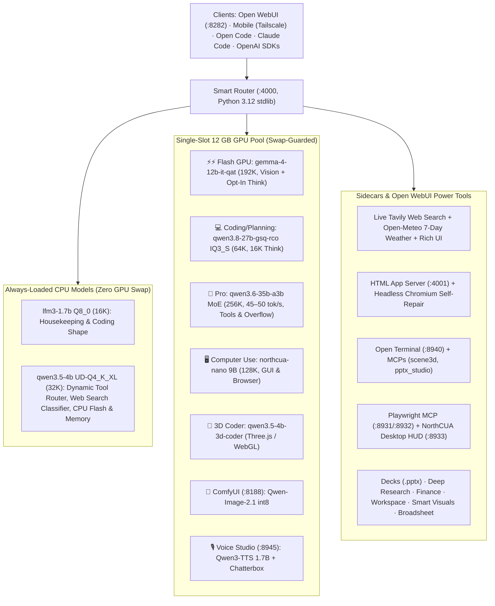

# OneRTX-AI-Stack

[](https://github.com/theogoogle/OneRTX-AI-Stack/actions/workflows/ci-clean-windows.yml)
[](LICENSE)

> **A full, private local AI workstation running on a single 12 GB consumer RTX GPU + 64 GB RAM (Windows 11).**

Built around a **zero-dependency Python stdlib router** speaking both OpenAI (`/v1/chat/completions`, `/v1/images/*`, `/v1/audio/speech`) and Anthropic (`/v1/messages`) APIs, **OneRTX-AI-Stack** turns one endpoint (`http://127.0.0.1:4000`) into an intelligent multi-model orchestrator for **Open WebUI**, **Open Code**, **Claude Code**, and any OpenAI-compatible SDK.

---

## Architecture



---

## Quick Start (Windows 11)

`install.ps1` checks what is already installed (`git`, Python 3.12, Node.js LTS, `uv`, LM Studio, plus optional `ffmpeg` / LibreOffice), installs missing tools cleanly via `winget`, creates isolated venvs, generates fresh local secrets, and deploys your selected modules idempotently:

```powershell
git clone https://github.com/theogoogle/OneRTX-AI-Stack.git
cd OneRTX-AI-Stack

# Interactive module picker (or pass flags below):
powershell -ExecutionPolicy Bypass -File .\install.ps1
```

### Modular Install Flags

| Flag | What it installs |
|---|---|
| *(default Core)* | Zero-dep Router (`:4000`), LM Studio presets, Open WebUI (`:8282`), HTML Server (`:4001`), Token Ledger, unit test suite |
| `-WithPowerTools` | `Simple Deck` & `Advanced Deck` (`.pptx`), Deep Research, Live Market & Finance, Smart Visuals, YouTube Transcript, Word/PDF Export, Google Workspace, Adaptive Memory |
| `-WithCodingAgents` | Open Terminal (`:8940`), OpenCode & Claude Code configs (`128K` context + `Pro` `256K` overflow), `claude-local`, `scene3d` & `pptx_studio` MCPs |
| `-WithComputerUse` | Playwright MCP (`:8931`/`:8932`) + keep-alive, NorthCUA Windows desktop & browser harness presets (`:8933`) |
| `-WithImages` | ComfyUI launcher, `extra_model_paths.yaml`, Qwen-Image-2.1 prompt enhancer |
| `-WithVoice` | Podcast & Story Voice-Cloning Studio (`:8945`, Qwen3-TTS 1.7B + Chatterbox Multilingual + `-16 LUFS` MP3 mastering) |
| `-WithBroadsheet` | Scheduled daily 1-page PDF broadsheet newspaper pipeline (`family-table/` with generic `config.example.json`) |
| `-All` | Installs every module above |

Useful flags for scripted or sandbox runs: `-SkipModels`, `-SkipSystemInstalls`, `-SkipScheduledTask`, `-InstallDir <path>`, `-RouterPort <port>`, `-WebUIPort <port>`, `-TailscaleHost <hostname>`, `-CheckOnly`, `-NonInteractive`.

### Verify Everything Offline / With Mock LM Studio

```powershell
python -I -X utf8 .\verify.py --install-dir "$env:USERPROFILE" --mock-lmstudio --run-unit-tests
```

Start or heal all configured services at any time:
```powershell
powershell -ExecutionPolicy Bypass -File %USERPROFILE%\.lmstudio\scripts\start-llm-stack.ps1
```

---

## What It Can Do

- **Dynamic Zero-Hardcoding Semantic Tool Routing (`50/50` benchmarked on `qwen3.5-4b`):** Automatically discovers Open WebUI custom tools and their docstrings at runtime (with `0/14` negative false positives and `3/3` on unseen tools) and shares the cached decision across `/route-check`, `decide()`, live web filtering, thinking budgets, and tool trimming.
- **2-Axis Smart Coding Router + Native OpenCode Dispatch:** Short snippets stay fast on Gemma 4 GPU; single-file logic/UI apps go to **Qwen3.8 27B (`IQ3_S`)** with `16K` `<think>`; 3D/physics simulations go to **Qwen3.6 35B-A3B (`MoE`)**; multi-file repos and test-verified builds automatically dispatch to **🧑‍💻 Open Code** via `/route-check`.
- **Up-to-Date Live Web Search & Weather (`50/50` benchmarked on `qwen3.5-4b`):** Triggers automatically for news, local events, schedules, prices, and fast-moving AI/software/hardware comparisons while keeping timeless science/CS theory offline. Renders verified news photos, clickable favicon citations, and 7-day **Open-Meteo** weather cards in Open WebUI.
- **HTML App Server + Headless Chromium Self-Repair:** Complete HTML/JS outputs save automatically to `:4001`, run through `html_check.js` in headless Chromium, auto-repair JS/overlay errors in 1 surgical `SEARCH/REPLACE` pass, and use surgical diff patches for follow-ups.
- **Computer Use (`NorthCUA-Nano 9B`):** Persistent Playwright browser control (`:8931`/`:8932` with page compression) and native Windows 11 desktop automation (`:8933`) guarded by an on-screen Allow/Deny popup, capture-excluded border HUD, and hardware `STOP` / `F8` emergency stop.
- **Local Images, Voice Cloning & Slide Studios:** ComfyUI (`Qwen-Image-2.1`) generation & conversational photo editing; `Qwen3-TTS` / `Chatterbox` EN/FR voice cloning; fast JSON-based `Simple Deck` (`.pptx`) and Vision-QA polished `Advanced Deck`; plus private **Deep Research**, **Live Market & Finance**, **Smart Visuals**, **YouTube Transcript**, **Word/PDF Export**, **Google Workspace**, and **Adaptive Long-Term Memory**.
- **Built-in Reliability & Security:** VRAM swap guard (never runs two GPU models concurrently), CPU **⚡ Flash (CPU)** GPU-busy fallback, streaming parallel tool-call loop guard, empty-after-thinking recovery, instant client-disconnect abort, `local_guard` SSRF/DNS-rebinding protection (`127.0.0.1` only), and a CSV Token Ledger synced to Open WebUI Analytics.

---

## Models Used (`models.json`)

| Tier | Model Key | Quantization | Placement | Context | Role |
|---|---|---|---|---|---|
| `background` | `lfm3-1.7b` | `Q8_0` | CPU (always loaded) | 16K | Titles, tags, Open WebUI housekeeping, 2-axis coding classifier |
| `flash` / semantic | `qwen3.5-4b` | `UD-Q4_K_XL` | CPU (always loaded) | 32K | Semantic tool router (`50/50`), web classifier (`50/50`), CPU chat fallback, memory |
| `fast` | `gemma-4-12b-it-qat` | Unsloth `UD-Q4_K_XL` + `F32` `mmproj` | Full GPU (~53–55 tok/s) | 192K | Everyday chat, vision, Vision QA, web-grounded answers, opt-in thinking |
| `think` / `code` | `qwen3.8-27b-gsq-rco` | ISTA-DASLab `IQ3_S` | Hybrid GPU/CPU (~12.3 tok/s) | 64K | Single-file apps, logic, Open Code & Claude Code primary coder |
| `deep` / `pro` | `qwen3.6-35b-a3b` | Unsloth `UD-Q4_K_S` (MoE) | Hybrid GPU/CPU (~45–50 tok/s) | 256K | Complex reasoning, 3D simulations, power tools, `>45K`/`>64K` overflow |
| `screen` | `northcua-nano` | `Q4_K_S` (9B VLM) | GPU (~73 tok/s) | 128K | Browser Use (`:8931`/`:8932`) & Desktop Use (`:8933`) |
| `3d` | `qwen3.5-4b-3d-coder` | `Q8_0` | GPU | 128K | Dedicated Three.js / WebGL scenes (`3d` tier & `scene3d` MCP) |
| `image` | `Qwen-Image-2.1` | `int8` (ComfyUI) | GPU | — | Local image generation & conversational/reference photo editing |
| `voice` | `Qwen3-TTS-1.7B` & `Chatterbox` | FP16/BF16 (sidecar) | GPU | — | EN/FR voice cloning & `-16 LUFS` mastered narration |

See [`models.json`](models.json) for exact Hugging Face repositories and filenames.

---

## Testing in Windows Sandbox (Optional)

If **Windows Sandbox** is enabled on Windows 11 Pro, double-click [`sandbox/OneRTX-Sandbox.wsb`](sandbox/OneRTX-Sandbox.wsb) to open a disposable Windows desktop with this repo mounted read-only and run:
```powershell
.\install.ps1 -WithPowerTools -SkipModels -NonInteractive
```

Clean-VM Continuous Integration runs on every push via [`.github/workflows/ci-clean-windows.yml`](.github/workflows/ci-clean-windows.yml) (`windows-latest`), testing `-CheckOnly`, clean installation, idempotent re-execution, `py_compile`, core unit tests, security origin guards, and live router endpoints against a mock LM Studio backend.

---

## License

MIT — see [`LICENSE`](LICENSE). Contributions welcome via [`CONTRIBUTING.md`](CONTRIBUTING.md).
